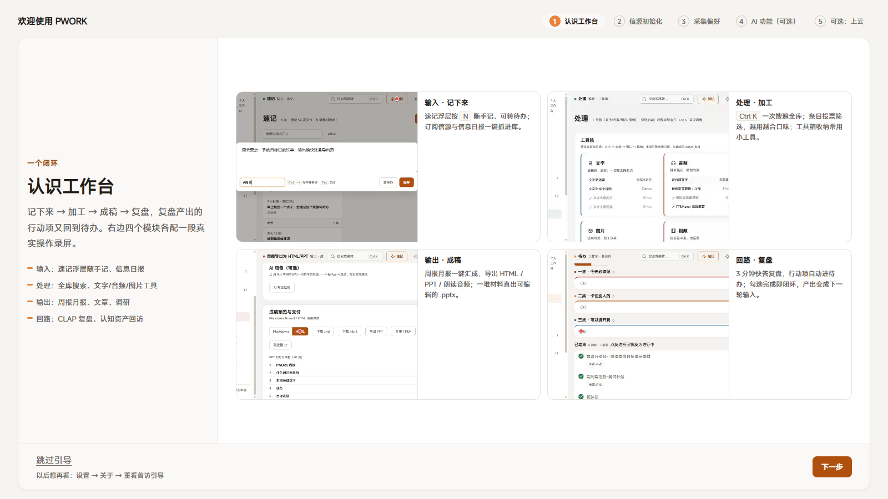

# PWORK · 个人工作台

[](./LICENSE)
[](https://github.com/LoganLink0/pwork/releases)

一个装在你电脑里的个人工作台：记下来、加工、成稿、复盘，四步连成一个循环。数据只属于你——不上传、不注册、断网也能用。开源免费，内测中（版本 0.1.x）。产品介绍页：https://loganlink0.github.io/pwork/



## 核心特性

- **四步一个循环**：速记与信源订阅（记下来）→ 一次搜索找出所有内容、投票筛选（加工）→ 周报月报与 PPT 生成（成稿）→ 3 分钟快答复盘、行动项自动进待办（复盘）——这一轮的产出自动变成下一轮的素材
- **数据不出你的电脑**：全部数据存在本机，随时可以打包搬到新电脑；没有账号，也没有任何「我们的服务器」
- **AI 配不配都行**：不配，信息筛选与报告生成全部用本机规则完成，功能完整；配上自己在大模型平台申请的 Key，解锁 AI 复盘教练、写大纲、联网调研——Key 只写进你电脑上的文件
- **云端是可选项**：想要全天候自动收信源、多设备同步，在你自己的 Cloudflare 账号下装一套（免费档每月 0 元，桌面版引导里一键部署）
- **48 个实测可用的信源**：11 个领域勾选订阅，每天自动收成一份信息日报
- **桌面版与浏览器版**：Windows 安装包，或下载源码在本机起服务后用浏览器访问（也可安装为浏览器应用）

## 下载安装（Windows）

到 [Releases 发布页](https://github.com/LoganLink0/pwork/releases) 下载安装包。两个安装包内容完全一样：

| 安装包 | 体积 | 适合 |
|---|---|---|
| `…-setup-online.exe` | 约 48MB | 推荐。绝大多数电脑已有浏览器运行时（WebView2），直接装；极少数没有的，安装时联网下载 |
| `…-setup-offline.exe` | 约 254MB | 完全离线的电脑（安装全程不联网） |

首次运行如果 Windows 弹出「已保护你的电脑」：点「更多信息」→「仍要运行」（安装包未购买代码签名证书，属预期）。覆盖安装即可升级，数据不受影响。

大陆访问 GitHub 慢？联网版也放在 [Gitee 镜像](https://gitee.com/LoganLink0/pwork/releases)（Gitee 平台规则：下载附件需注册/登录 Gitee 账号；离线版仅在 GitHub）。

## 快速上手

1. 第一次打开自动进入 5 步引导：四模块演示视频、按领域挑信源、写下你的关注点、AI 怎么配（可不配）、可选的云端抓取
2. 设置 → 数据：把「自动备份」打开（默认每周）
3. 任何时候按 <kbd>Ctrl</kbd>+<kbd>K</kbd> 搜索全部内容；桌面版按 <kbd>Ctrl</kbd>+<kbd>Alt</kbd>+<kbd>Q</kbd> 呼出工具轮盘

装完的完整指引（信源、AI Key、数据搬家、已知边界）见 [发布说明.md](./发布说明.md)。

## 文档

- [发布说明.md](./发布说明.md)——安装、首用三步、数据怎么搬（使用者从这里进）
- [project-overview.md](./docs/project-overview.md)——项目整体说明与全量文档索引（想深入了解从这里进）
- [architecture.md](./docs/architecture.md) / [DESIGN.md](./docs/DESIGN.md)——架构与数据流 / 视觉规则
- [development.md](./docs/development.md)——开发方式、回归清单、发布打包
- 应用内「帮助」页——功能清单与配置指南，装好后直接看

## 开发

本机跑起来（Node ≥ 20）：

```bash
cd app
npm install
npm run dev        # 端口 5273，AI 网关自动随启
```

桌面安装包：`cd app && npx tauri build`（默认联网版；离线版与发布流程见 [development.md](./docs/development.md) 的「发布打包」）。云端服务在 [worker/](./worker/README.md)，双击 `worker\部署向导.cmd` 走中文向导即可部署。前端细节见 [app/README.md](./app/README.md)。

回归基线：404 项自动化测试全绿、tsc 零错误、lint 24 警告 0 错误。

## 许可证

[MIT](./LICENSE)——可以自由使用、修改、分发，保留许可证声明即可。
