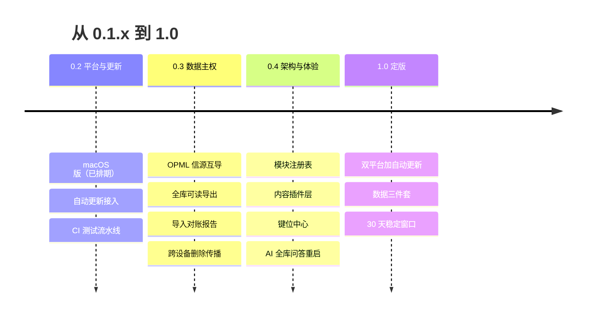

# 05 · 路线图

> 原则沿用：**每一阶段产品都完整可用；先验证价值再投入架构**。2026-10-29 全面刷新（0.1.10 发布后）：本文档以未来计划为主体，W0–W5 交付历程压缩为文末速览（详录在 git 历史与 TODO.md 已完成区）。

## 现状判断（2026-10-29，0.1.10 时点）

**功能面**：四模块闭环全量可用，功能供给跑在真实使用前面——近一个月已有三例功能上线后回撤或退役（AI 全库问答回撤、评分权重退役、自进化四批次复判不切实际，均见 TODO 留档）。结论：新增功能从紧，工程量优先让给平台覆盖、更新触达与数据主权。

**分发面**：Windows 单平台 + 手动下载安装。macOS 已排期（TODO 六步）；自动更新的托管源已拍板（GitHub Releases）且签名密钥已备，实施只差排期。内测期发版频繁，用户停留在旧版本的比例直接由更新到达效率决定。

**数据面**：「数据只属于你」当前兑现了一半——机器可恢复的备份包裹（v2）完整且经恢复演练；人类可读导出只有局部（档案按月导出、Obsidian 日报），信源清单没有标准格式互导（OPML），跨设备彻底删除不传播（架构已知边界）。

**架构面**：依赖方向单向、engine 零 React、处理工具已有注册表（processTools.ts），基础良好。扩展成本的大头在入口维护：新增一个功能页要分别改路由、导航、命令面板、帮助四处，靠契约测试兜底拼写，缺单点注册。

## 主轴与阶段刻度

**0.1.x → 1.0 的路：平台补全 → 分发闭环 → 数据主权补全 → 内部模块化 → 体验与功能深化 → 定版。**

0.2 与 0.3 顺序执行；0.4 各项相互独立，可随前两个阶段穿插推进（刻度表达优先级，版本号按批次完成度递增）。

## 一、用户体验

1. **移动端一等公民化**（触发条件：手机真机验收完成、确认真实使用场景后投入）。当前手机端是「布局可用的数据镜像」，升格路线：速记浮层手机化（移动端最高价值场景是随手捕获）→ 信息日报通勤阅读与投票优化 → PWA 安装引导。两条硬约束：本地优先立场不变；手机取数通路要重做——设备同步的 D1 拉取当前走电脑网关（`/d1`），手机场景需要浏览器直连 Cloudflare 官方接口的通路，凭据安全方案随设备同步首验一并拍板。
2. **键位中心**：全局键已有 4 个加轮盘键，按既有排期判断等键位再增多时启动——帮助页动态渲染全部键位、设置页可自定义、冲突校验三件一批做。
3. **空态与首次价值路径一致化**：首页空态卡已是虚线引导标准，各模块页空态逐页统一到同一标准；验收口径=新用户从安装到看到第一份信息日报全程无死胡同、无文档依赖。
4. **迁移体验产品化**（与 0.3 联动）：换机从「读指引文档」变为「导出 → 新机导入 → 对账报告」三步向导。
5. **维持项**：界面文案检查表（AGENTS 纪律 5）随每个功能批执行；对比度与焦点管理按视觉审查清单持续；五万条压测基线每季度复跑；暗色与窄屏巡检随每个新功能批附带。

## 二、新增功能（从紧）

原则：先重启已暂停项，再开新项；每个候选先过一问——最近一周我自己用过吗。

1. **自动更新**（0.2）：tauri-plugin-updater，更新包与签名清单挂 GitHub Releases 资产（托管源 2026-10-26 已拍板）。这是分发功能，优先级排在一切新功能之前：它决定后续每个版本能否到达用户。
2. **AI 全库问答重启**：按既有前置推进——上下文升到正文级（速记正文/任务状态与期限/条目摘要/洞察全文按字数预算进提示词），先不依赖嵌入验证效果；检索升级（嵌入索引）作为第二段，嵌入来源在已接入厂商中逐一查证官方文档后选定，或用本地 ONNX 模型（约 100MB，网关进程内运行）。
3. **网关按用途配模型**：云端 worker 已是两段式实例（便宜模型预筛 + 强模型评分）；本地网关把「全局单模型固定」升级为「按用途固定」——问答、筛选、摘要、嵌入各自绑定一个确定模型，设置页明示。保留「模型由网关统一管理、前端不可随意指定」原则。
4. **信源目录社区化**：目录从维护者自测快照（11 领域 48 源）转为开源仓库可 PR 贡献的清单，CI 定时逐源验证 feed 活性，失效源自动开 issue 提醒贡献者处理。
5. **输出模板自定义**（触发：真实使用中提出）：周报/报告结构可编辑存为模板。
6. **数据视频 O5**：维持既有决策，等明确用途再启动。
7. **边界维持（明确不做）**：遥测与账号体系、界面国际化、多人协作、代码签名证书购买。

## 三、数据可迁移性（0.3 主线）

目标：①离开 PWORK 也能带走一切；②任何历史版本的备份在最新版都能导入。

1. **OPML 信源互导**：信源清单进出 RSS 阅读器通用格式，与既有 JSON 导入导出并存。
2. **全库人类可读导出**：速记/条目/任务/目标/复盘/洞察各一目录的 Markdown（frontmatter 带元数据），风格与既有 Obsidian 日报导出一致；同格式支持导入回库——导出格式即迁移格式，进出对称。备份包裹面向恢复，这套面向带走。
3. **导入对账报告**：导入完成展示各表导入前后条数与合并处置（新增/更新/跳过），把「写库前后对账」的工程纪律变成用户可见的交付。
4. **跨设备删除传播**：本地「彻底删除」推送墓碑或清理指令（云端 worker 端墓碑机制已有），补齐推送侧与拉取侧。
5. **备份格式测试矩阵**：v1（FUPAN）× v2（当前）× 未来版本的全组合导入回归固化为测试；格式变更记录文档化。定版时冻结格式并公示兼容承诺。
6. **D1 全量导出端点**：worker 增加一次性拉取全部同步记录的端点，设备重建不依赖逐日增量。
7. **导出口令加密**（触发：出现备份落公用磁盘或对外传输备份的真实场景）：导出包裹可选口令加密，导入侧解密。
8. **规模预案**（触发：单份备份超过 50MB）：分卷导出与流式导入。五万条实测当前数据量远低于此，触发条件先立在文档里。

## 四、功能模块化插件化（三层，先内后外）

判断：单人维护的本地优先产品直接做第三方代码插件（Obsidian 式），API 稳定负担与安全面都承受不起，现阶段不做。模块化按三层推进，每层独立有价值：

1. **内部模块注册表**（0.4 首项）：模块/工具一次注册，路由、导航、命令面板、帮助四处入口全部自动获得——把处理工具注册表（processTools.ts）的经验推广到页面模块级。新增功能页从改四处降为改一处，契约测试从「兜底拼写」升级为「注册表天然保证」。
2. **内容插件层**（数据即插件，零代码执行）：信源目录、场景包（[07 设计](./07-场景包设计.md)已在档）、输出模板三类内容资源走统一格式与贡献通道，社区可 PR。安全面为零，是开源生态的自然起点。
3. **连接器抽象推广**：AI 厂商 16 家已是「描述文件 + 实现」的连接器实例（端点/拿 Key 页/默认模型）；把同一抽象推广到搜索、嵌入、语音合成等外部能力——新厂商接入=新增一份描述与实现，框架不动。
4. **第三方代码插件：不做**。触发条件：开源社区出现真实的外部开发者贡献代码的需求，且完成进程隔离方案的安全预研。在此之前一律引导走内容插件层与连接器层。

## 五、平台、质量与开源生态

1. **平台**：macOS（0.2，六步已在 TODO）→ 自动更新 → Linux（触发：GitHub/Gitee 出现明确的 Linux 使用诉求；Tauri 打 deb/AppImage 的工作量与 macOS 批相当）。
2. **质量**：CI 测试流水线——app 406 + worker 19 进 GitHub Actions，与 macOS 出包工作流同批建立（Actions 已经要跑，测试 job 顺带挂上）；lint 警告清零（review 模块重构债独立批，约 24 条）；多标签页同库并发协调维持低优先（单用户低险，已知边界留档）。
3. **开源生态**：CONTRIBUTING 与 issue 模板随信源目录社区化一并建立（当前无外部协作流量，提前建无人使用）；演示版随每版重建发布；发布说明维持中文分层（快速上手/进阶/可选自部署）。
4. **安全维持**：新依赖入账纪律与年度 Mimosa 深扫维持；wrangler 工具链公告观察项跟踪上游修复。

## 定版标准（1.0 门槛，逐条满足才定版）

1. Windows + macOS 双平台稳定，自动更新上线并经真实升级验证（含失败回退）。
2. 数据主权三件套齐备：全库可读导出、OPML 互导、导入对账报告；备份格式冻结并公示兼容策略。
3. 连续 30 天无数据丢失级缺陷（错误日志与用户反馈双口径）；五万条压测基线复跑通过。
4. 帮助页 / user-guide / 发布说明 / README 四处与实际功能一致（每版发布前过一遍检查表）。
5. 定版承诺公示：schema 与备份格式的向后兼容策略、旧版本支持窗口。

定版之后进入正常演进节奏：功能按第二节原则滚动，兼容承诺按第 5 条执行。

## 已交付历程速览（2026-08～10；详录见 git 历史与 TODO.md 已完成区）

- **W0–W5**（2026-08-30～09-02）：文档基座 → 壳+输入骨架 → 信息采集 C1 → 回路迁入+数据统一 → 采集上云（Cloudflare Worker + D1 部署）→ 闭环自动化。
- **W5+ 增补**（2026-09-01～09-11）：处理四模态工具箱、输出 O1–O4、任务目标交互定稿、场景包设计与简历辅导实装——后者拆出独立项目 resume-coach，确立「PWORK 是壳，业务场景独立成项目」的架构原则。
- **2026-10 分发与定版前批次**：桌面壳（Tauri）与安全审计、记录级增量设备同步、评分体系重设计、开源（GitHub + Gitee + 介绍页 + 演示版）、0.1.8–0.1.10 三版发布、应用内一键部署、AI 厂商 16 家。

## 长期储备（未排期，触发条件制）

- 假设校验 P2：云端 AI 筛选数据积累到可分析量时回看。
- 采集 C4 本地伴生服务：超过 30% 信源需登录态抓取时启动。
- 逻辑树/因果循环图跨模块复用：回路工具开放给处理模块。
- 协作与在线服务：需后端与账号，与本地优先立场冲突，真实多人需求出现再议。
